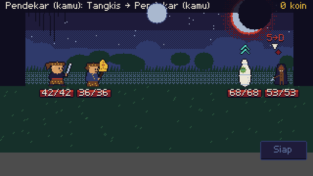
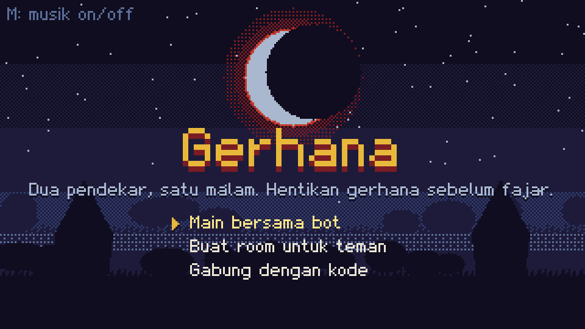
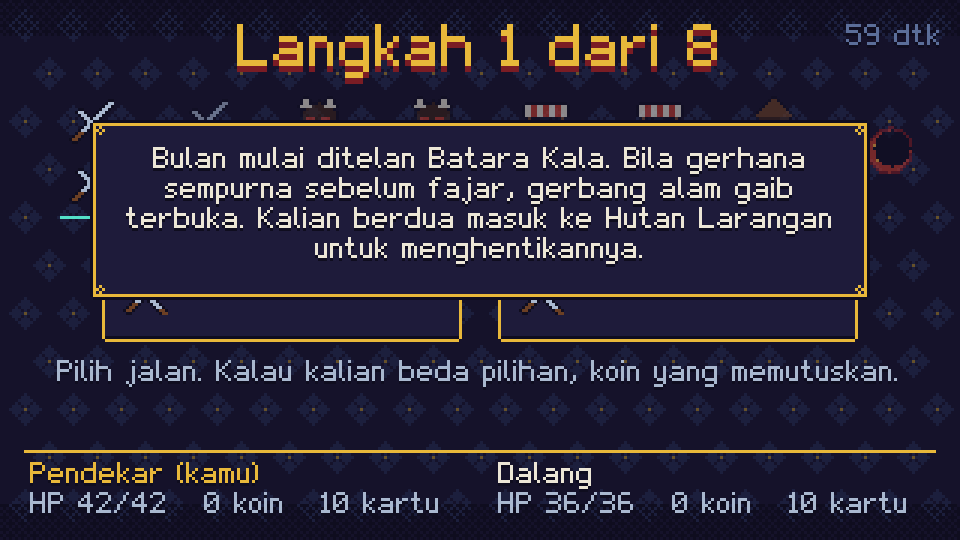
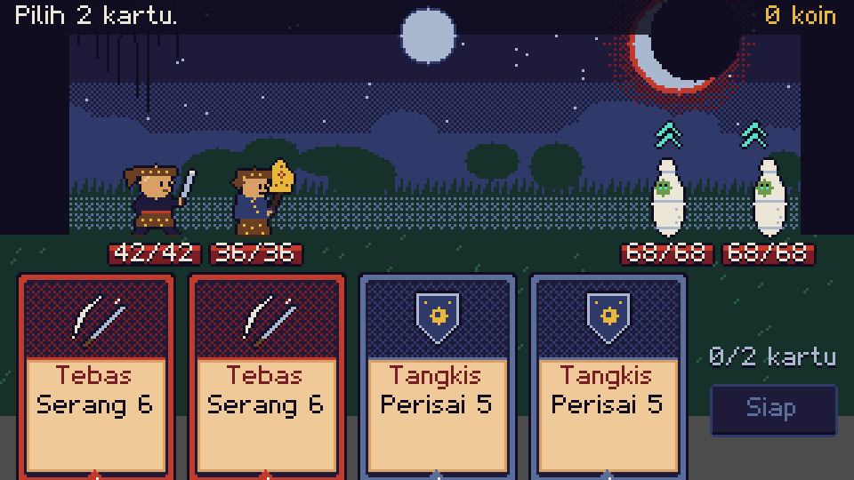
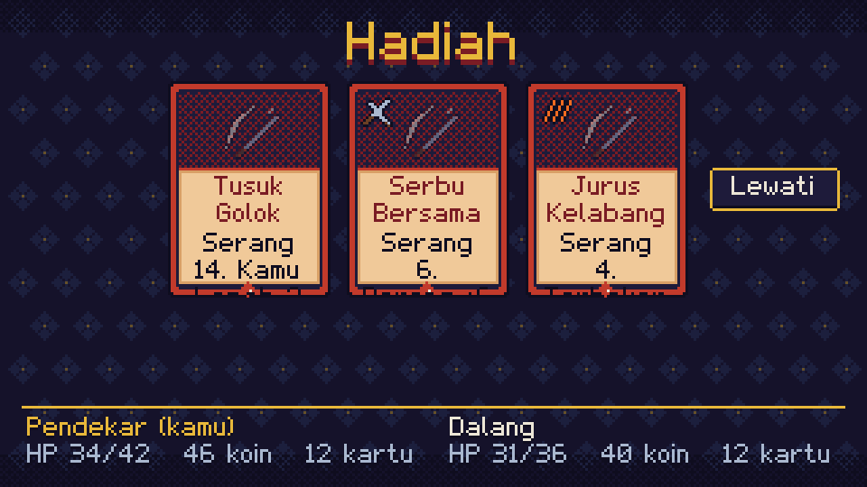
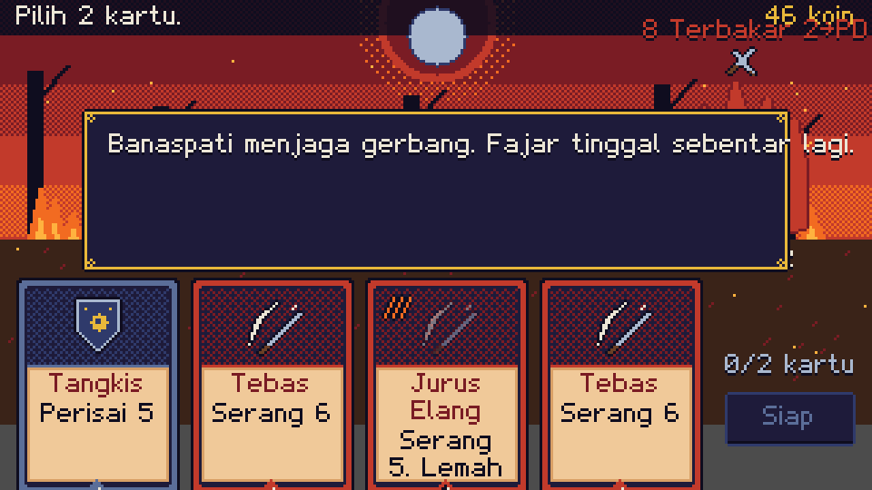
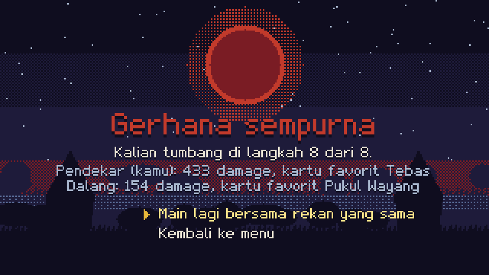

<div align="center">

# Gerhana

**A two-player co-op deckbuilder set in Indonesian folklore.**

Batara Kala is swallowing the moon. If the eclipse completes before dawn, the gate to the spirit world opens.
Two pendekar walk into the Forbidden Forest to stop it, one night, one run.



Godot 4 · TypeScript · Bun · pixel art, music and font generated from code

</div>

---

## How it plays

- **Pick 2 of 4.** Each turn you draw four cards and play exactly two. There is no energy to count.
- **Both players choose at the same time.** Picks stay hidden until both of you press **Siap**. Then the turn resolves in a fixed order: shields and support first, attacks second, enemies last.
- **Enemies show what they will do** before you choose, so you can protect your partner or race the damage.
- **The co-op mechanics reward playing together:**
  - **Bareng (Serempak):** a bonus when both of you hit the same enemy.
  - **Jurus Berantai:** the Pendekar's combo chain.
  - **Wayang:** shields the Dalang puts up for either player.
  - **Ping:** marks a target for your partner without voice chat.
- **A run takes about 15–20 minutes:** seven map steps, each a vote between two paths (fight, elite, rest, shop), then the boss Banaspati.

| | |
|:---:|:---:|
|  |  |
| **Title**: the eclipse is the turn timer too | **Map**: vote a path; a coin breaks ties |
|  |  |
| **Combat**: intents above enemies, pick 2 of 4 | **Reward**: one card after every win |
|  |  |
| **Boss**: Banaspati, a living flame | **End**: damage and favourite card per player |

## The cast

**Heroes**
- **Pendekar Silat:** the striker, built around Jurus chains.
- **Dalang:** the puppeteer, who supports with wayang shields and blessings.

**Enemies**
- **Normal:** Tuyul (steals your coins), Kuntilanak, Pocong, Babi Ngepet, Jenglot.
- **Elite:** Genderuwo, Wewe Gombel.
- **Boss:** Banaspati.

Every card, enemy and relic (Pusaka) is data in [`packages/rules/src/content`](packages/rules/src/content).

## Play it locally

You need [Bun](https://bun.sh) and [Godot 4.7](https://godotengine.org).

1. Start the server:

   ```bash
   bun install
   bun packages/server/src/server.ts
   ```

2. Open `client/project.godot` in Godot and press **F5**.

3. Choose a mode:
   - **Main bersama bot:** play alone; the bot plays the Dalang and follows your map vote.
   - **Buat room untuk teman:** share the six-letter code with a friend, who picks **Gabung dengan kode** and types it.

**Controls**

| Action | Input |
|---|---|
| Pick a card | Click it. A Serang (attack) asks for an enemy, a Bantu (support) for a hero, and a Tahan (block) targets yourself. |
| Confirm your two cards | **Siap** |
| Mark an enemy for your partner | Click it, or right-click while choosing a target |
| Music on or off | **M** |
| Read a card's full rules | Hover it |

The moon at the top is the 30-second turn timer. When it turns red, the server plays your first two cards for you. A dropped connection gets two minutes to come back to the same seat.

### Web build

Install the **Web Single-Threaded** export template in Godot first. Then export:

```bash
godot --headless --path client --export-release "Web" ../build/web/index.html
```

Serve the build:

```bash
python3 -m http.server 8060 --directory build/web
```

Open http://localhost:8060. The engine is about 10 MB compressed and the game data 1.4 MB.

## How it's built

```
packages/rules    pure, deterministic TypeScript: combat, run flow, content, bot (no I/O)
packages/server   Bun WebSocket rooms; validates every message, the only source of truth
packages/sim      bot-vs-bot balance simulator
client            Godot 4 GDScript client; draws state and animates server events
art               Python generators for every sprite, icon, background, the font and the music
docs              game design document and implementation plans
```

- **The server is authoritative.**
  - The client never decides an outcome: it sends picks and plays back the events.
  - Hands stay hidden from the other player.
  - Picks for a turn that has already resolved are rejected.
  - Every message is shape-checked, rate-limited and origin-checked.
- **The rules are deterministic.** The same seed and the same picks always replay to the same state, which is how bugs get reproduced.
- **Balance comes from the simulator, not guesswork.** Bot pairs win about **33%** of runs, a run lasts about **17 minutes**, and no reward card is taken more than 60% of the time. Run the check with:

  ```bash
  bun run --filter @gerhana/sim sim -- --runs 2000
  ```

- **Every asset is code.**
  - `python3 art/build.py` regenerates the 32×32 sprites with idle/attack/hit animations, the card frames, icons, backgrounds, *Aksara Malam* (the game's own pixel font) and three 8-bit gamelan loops in a slendro scale.
  - Open `art/gallery.html` through a local server to browse them all.

```bash
bun test   # 105 tests: rules, rooms, protocol, server
```

## Status

A playable MVP: one act, two heroes, a full run to the boss, online co-op with a bot fallback, and a web build.

Coming next:
- hosting so friends can join from a link
- iOS
- art for the 30 reward cards
- sound effects
- English text

The full plan is in the [game design document](docs/superpowers/specs/2026-11-06-gerhana-mvp-design.md).
